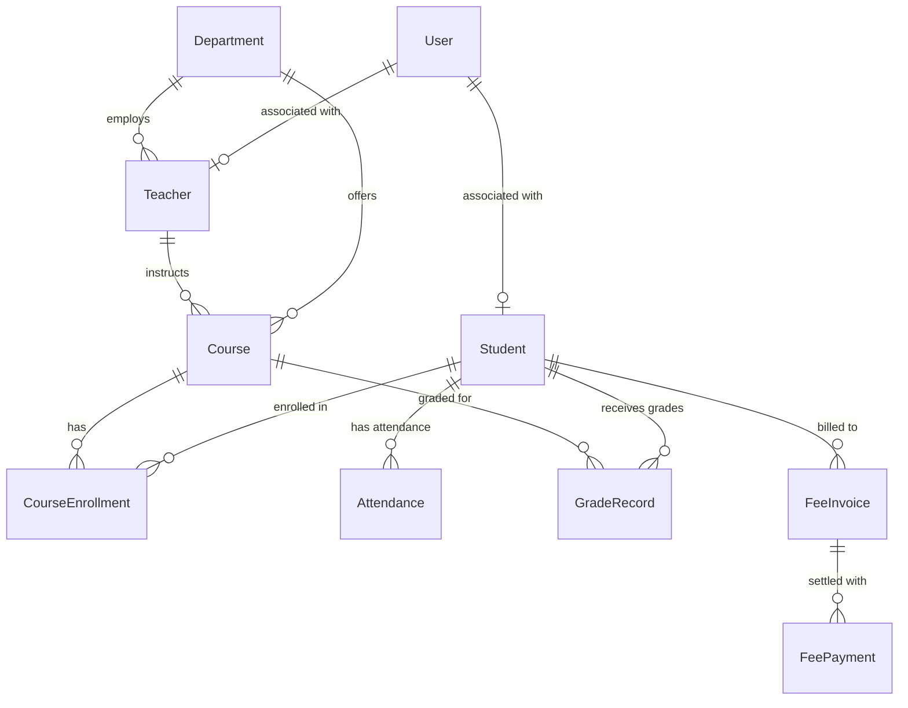

# Student Management System — Architectural Specification

## 1. System Overview

The **Student Management System (SMS)** is engineered as a decoupled, multi-tier enterprise web application featuring:
1. **Frontend**: Modern Single-Page Application (SPA) built with React 19, Vite, React Router DOM, Axios, and custom glassmorphism styling.
2. **Backend**: Robust RESTful service built with Python 3, Django 5, and Django REST Framework (DRF), powered by SQLite with relational database integrity and Token-based authentication.

---

## 2. Directory Architecture

```
STUDENT-MANAGEMENT-SYSTEM/
│
├── frontend/                     # React Single-Page Application
│   ├── public/                   # Static assets, SVG & ICO favicons
│   ├── src/
│   │   ├── assets/               # Brand assets and graphics
│   │   ├── components/           # Reusable UI (Navbar, Footer, Modal, StatCard, etc.)
│   │   ├── context/              # AuthContext & global state providers
│   │   ├── hooks/                # Custom React hooks (useAuth)
│   │   ├── layouts/              # MainLayout with sticky glass navbar and footer
│   │   ├── pages/                # Route views partitioned by role
│   │   │   ├── admin/            # AdminDashboard, Student, Department, Course, Fee Mgmt
│   │   │   ├── auth/             # Login and Registration views
│   │   │   ├── student/          # StudentDashboard, Report Card, Tuition & Fees
│   │   │   └── teacher/          # AttendanceManagement, GradeManagement
│   │   ├── routes/               # AppRoutes and ProtectedRoute with RBAC
│   │   ├── services/             # Modular Axios API clients (auth, student, grades, etc.)
│   │   ├── styles/               # Design system and typography styles
│   │   ├── utils/                # Formatters, constants, and helper functions
│   │   ├── App.jsx               # Top-level Router and Context wrapper
│   │   └── main.jsx              # Application entry point
│   ├── package.json              # NPM dependencies and scripts
│   ├── vite.config.js            # Vite build and dev-server configuration
│   ├── .env                      # Local environment configuration
│   └── .env.example              # Environment variables template
│
├── backend/                      # Django REST Framework Backend
│   ├── config/                   # Core Django project configuration
│   │   ├── settings.py           # CORS, DRF, Database, Auth settings
│   │   ├── urls.py               # Root URL router mapping to all apps
│   │   └── wsgi.py               # WSGI entry point
│   ├── apps/                     # Modular Django domain applications
│   │   ├── accounts/             # Custom User model, Auth views, Tokens
│   │   ├── attendance/           # Daily & batch attendance tracking
│   │   ├── courses/              # Courses, credits, teacher links, enrollments
│   │   ├── departments/          # Academic departments and codes
│   │   ├── fees/                 # Fee invoices, payment receipts, summaries
│   │   ├── grades/               # Examination marks, GPA computation, report cards
│   │   ├── students/             # Core student records, live analytics, CSV export
│   │   └── teachers/             # Faculty profiles and designations
│   ├── manage.py                 # Django management CLI
│   ├── requirements.txt          # Python dependencies
│   ├── db.sqlite3                # Relational SQLite database
│   ├── test_e2e.py               # Automated end-to-end integration test suite
│   └── .env.example              # Backend environment template
│
├── docs/                         # Technical documentation
│   ├── architecture.md           # System architecture specification
│   └── api_reference.md          # REST API endpoints reference
│
├── backup_data/                  # Safe backup of legacy JSON and SQLite data
├── .gitignore                    # Git ignore rules for node_modules, venvs, artifacts
└── README.md                     # Complete project documentation and run guide
```

---

## 3. Authentication & Role-Based Access Control (RBAC)

The application implements strict role-based access control across both the backend APIs and frontend routes:

### User Roles:
1. **Academic Coordinator / Administrator (`admin`)**:
   - Full read/write access to student profiles, departments, courses, teachers, fee invoices, attendance, and grades.
   - Access to high-level academic metrics, export tools, and faculty management.
2. **Teacher / Faculty (`teacher`)**:
   - Access to student directory.
   - Classroom attendance recording (daily individual & batch attendance entry).
   - Grade and examination marks management (assignments, midterms, finals).
3. **Student (`student`)**:
   - Personalized student portal.
   - Real-time attendance percentage breakdown and warnings if below 75%.
   - Academic report cards with CGPA, individual subject grades, and pass/fail status.
   - Tuition fee status, invoice records, and payment history.

### Authentication Flow:
1. The user logs in via `POST /api/auth/login/` with email and password.
2. The backend validates credentials and issues a DRF `Token`.
3. The frontend stores the token in `localStorage` and injects it via Axios request interceptors into the `Authorization: Token <token>` header.
4. `ProtectedRoute.jsx` intercepts route changes, verifying token presence and checking user role privileges before rendering protected components.

---

## 4. Database Schema & Relational Integrity

All domain models are managed through Django's ORM:



### Dynamic Calculated Fields:
- **`Student.attendance_pct`**: Automatically computes `(Present Sessions / Total Sessions) * 100`.
- **`Student.average_marks`**: Dynamically computes average marks across all examination records.
- **`Student.at_risk`**: Flags `True` if attendance is `< 75%` or average marks are `< 50%`.
- **`GradeRecord.gpa` & `GradeRecord.grade`**: Automatically evaluated using standard 4.0 scale:
  - `>= 90%`: `A+` (4.0)
  - `>= 80%`: `A` (3.7)
  - `>= 75%`: `B+` (3.3)
  - `>= 70%`: `B` (3.0)
  - `>= 65%`: `C+` (2.7)
  - `>= 60%`: `C` (2.3)
  - `>= 50%`: `D` (2.0)
  - `< 50%`: `F` (0.0)
